<div align="center">

# Velox

**A modern, fast, battery-friendly native Rust GUI framework.**

Write expressive, declarative Rust once to ship native apps across Desktop, Mobile & Web — with **75+ themed widgets**, **spring physics motion**, **real-time frosted glass effects**, and **0% CPU idle sleep**.

<p>
  <a href="README.md">简体中文</a> &nbsp;|&nbsp; <strong>English</strong>
</p>

<p>
  <a href="https://crates.io/crates/velox-kit"></a>
  <a href="https://docs.rs/velox-kit"></a>
  <a href="LICENSE"></a>
  
</p>

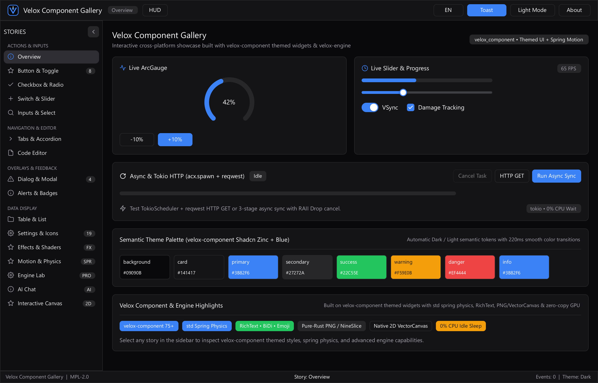

</div>

---

## Why Velox?

- **🎨 75+ Production-Ready Themed Widgets**: Built-in Shadcn / Tailwind-inspired design system with instant Light/Dark themes and i18n — buttons, forms, password visibility toggle, borderless grouped OTP inputs, calendar, code editor (with pixel-accurate native IME caret tracking), sortable tables, interactive charts, drawers, dialogs, and AI chat streams.
- **✨ Declarative Motion 2.0 & 0% CPU Idle**: Velocity-inheriting second-order springs, container-level `.auto_animate()` + `.stagger()`, zero-config ghost exits (symmetric open/close animations across dialogs, sheets, dropdowns, popovers, and accordions), compositor `.flip_layout()` with inverse corner-radius scaling, hyperbolic rubberband overscroll, and native shared-element `Tabs` spring underlines — automatically settling to **0% CPU** when idle.
- **🗺️ High-Density 2D Interactive Canvas (`velox-canvas`)**: GPU-instanced SDF rendering (32B static geometry + 4B dynamic state) for thousands of arbitrarily rotated OBBs, Hilbert R-Tree picking & marquee selection, semantic LOD, `Minimap`, AI DAG node graphs, 1M-row virtual `SheetGrid`, 100k-point LTTB plots, and optional custom WGSL shaders.
- **🪟 GPU-Accelerated Effects & Memory Discipline**: Lightweight 2D GPU renderer (with automatic software fallback) featuring multi-stop OKLab gradients, two-circle focal radial gradients, real-time Acrylic frosted glass, 27 blend modes, SVG path clipping, 64×64 spatial-binned occlusion culling, and byte-budgeted image/offscreen texture pools.
- **⚡ Fluent Tailwind-Style Rust API**: No WebView bloat, no HTML/CSS bridge, no heavy macro DSLs. Compose responsive Flexbox & Grid interfaces directly in idiomatic Rust.
- **📱 Cross-Platform & Zero-Copy Host Interop**: Native support for **Windows, macOS, Linux (Wayland / X11), Android, iOS, HarmonyOS NEXT**, and **WebAssembly**; zero-copy external 3D/map/video texture import and transparent GPU HUD embedding inside Qt, WPF, WinUI 3, and GTK4.

---

## 30-Second Quick Start

Add `velox-kit` to your `Cargo.toml`:

```toml
[dependencies]
velox-kit = "0.4"
```

Build your first native Velox desktop app:

```rust
use velox_kit::prelude::*;

pub struct HelloWorld {
    clicks: u32,
}

impl View for HelloWorld {
    fn render<'a>(&mut self, cx: &'a mut Scope<Self>) -> Element<'a> {
        let on_click = cx.listener(|this, _: ClickEvent, _| {
            this.clicks += 1;
        });

        div()
            .flex_col()
            .gap(12)
            .size_full()
            .items_center()
            .justify_center()
            .bg(cx.theme().background)
            .child(
                cx,
                text(fmt!(cx, "Hello, Velox! ({})", self.clicks))
                    .size(20)
                    .color(cx.theme().foreground),
            )
            .child(
                cx,
                Button::new(1, "Let's Go!")
                    .primary()
                    .medium()
                    .on_click(on_click),
            )
            .into_element(cx)
    }
}

fn main() {
    velox_kit::application().run(|cx| {
        velox_kit::init(cx);
        velox_kit::open_window(
            WindowOptions::new("Hello Velox").size(480, 320),
            cx,
            |cx| cx.new(|_| HelloWorld { clicks: 0 }),
        )
        .expect("Failed to open window");
    });
}
```

### Explore the 16-Story Interactive Gallery

```bash
# Launch the native GPU-accelerated component gallery (1280×820)
cargo run -p desktop_app

# Jump straight to highlight stories (with optional Light mode & live i18n)
cargo run -p desktop_app -- --story canvas
cargo run -p desktop_app -- --story motion
cargo run -p desktop_app -- --story effects
cargo run -p desktop_app -- --story chat
cargo run -p desktop_app -- --story inputs --light --lang zh
```

---

## Live Gallery Showcase

Every screenshot below is rendered natively by Velox at **1280×820 (2× HiDPI)** — zero WebView, zero HTML/CSS:

### Instant Dark / Light Themes & Live Localization

| Dark Theme (English) | Light Theme (Live Chinese Switch) |
| :---: | :---: |
|  | 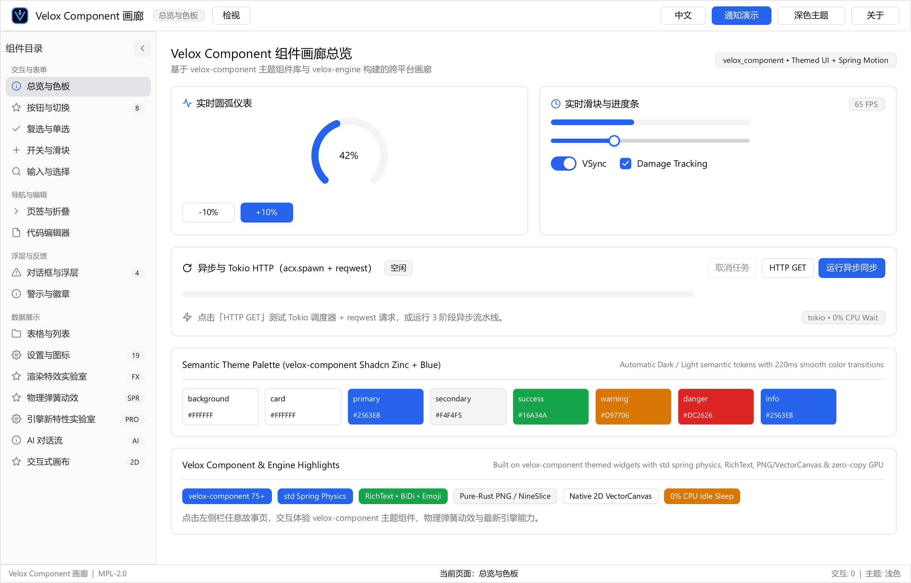 |
| Full app shell, live interactive gauges, Tokio async workflow demo, and semantic color tokens. | Zero-restart switching between Light/Dark themes and static localization catalogs. |

### High-Density 2D Interactive Canvas & Declarative Motion 2.0

| 2D Rotated OBB Canvas, Minimap & LiquidGlass | Motion 2.0 (AutoAnimate / FLIP / Rubberband / Springs) |
| :---: | :---: |
| 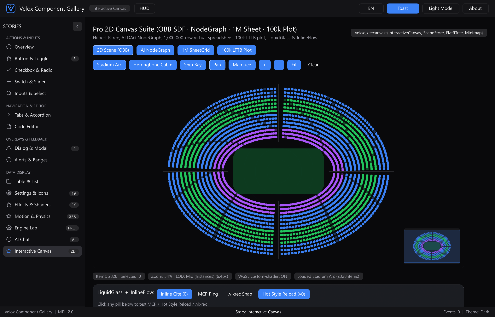 | 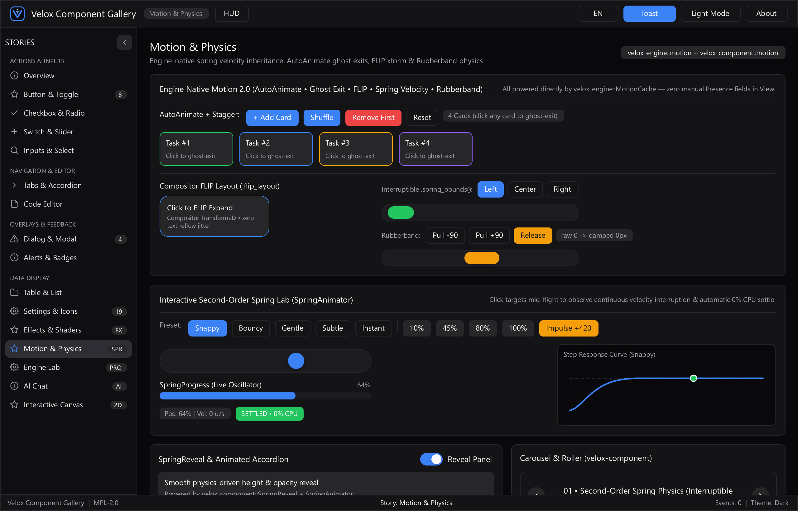 |
| Multi-slot GPU-instanced 2,300+ rotated OBB seats, Minimap, AI NodeGraph, 1M SheetGrid & 100k LTTB plots. | Zero-config list reflow & ghost exits, compositor FLIP inverse radii, rubberband damping & 0% CPU idle. |

### GPU Effects Lab & Navigation Tabs / Accordion

| Real-Time Frosted Glass, OKLab Gradients & Blend Modes | Elevated Segmented, Shared-Element Spring Underline & Accordion |
| :---: | :---: |
| 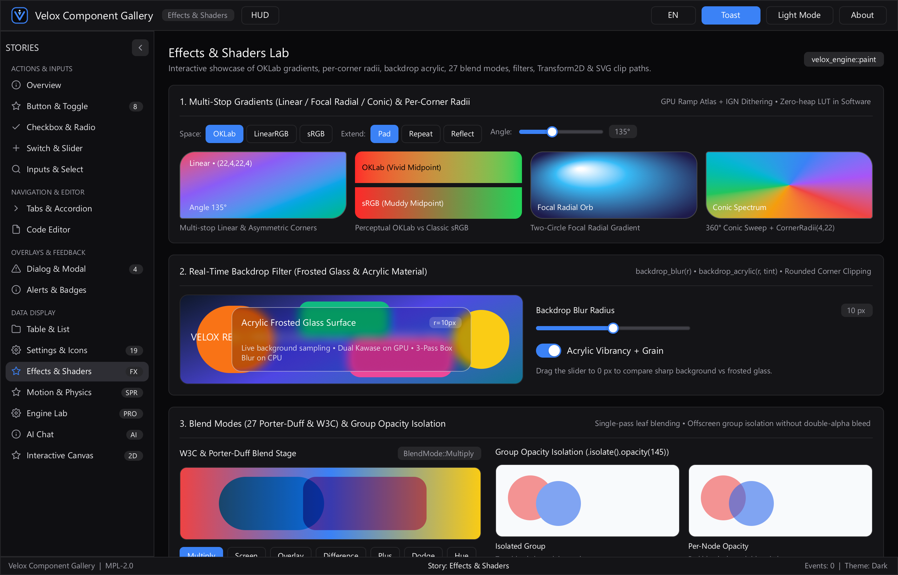 | 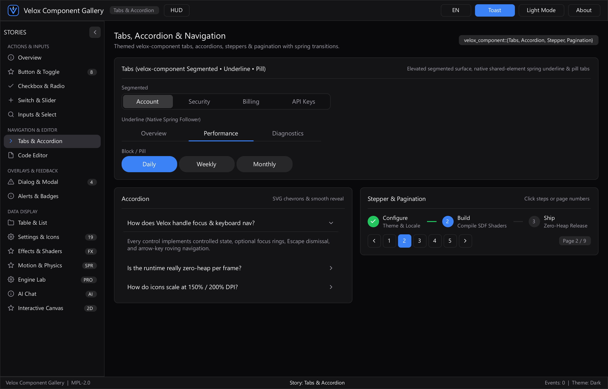 |
| Perceptually uniform OKLab gradients, focal radial orb, live Acrylic backdrop blur, 27 blend modes & SVG clipping. | Crisp dark-mode `Segmented`, native single-line spring `Underline`, symmetric `Accordion` & `Pagination`. |

### AI Streaming Chat & RichText / Vector Canvas

| Animated AI Chat & Token Streaming | RichText BiDi / Emoji, Image Pipeline & VectorCanvas |
| :---: | :---: |
| 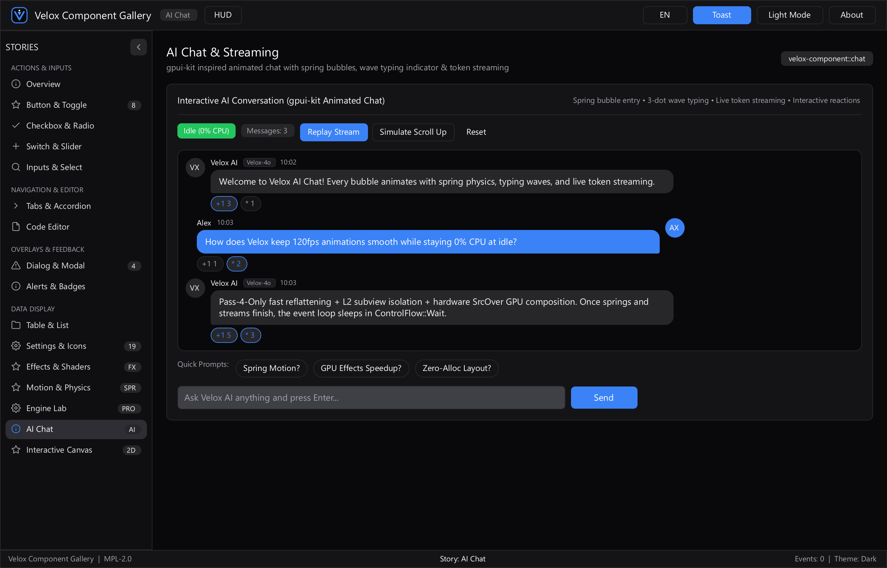 | 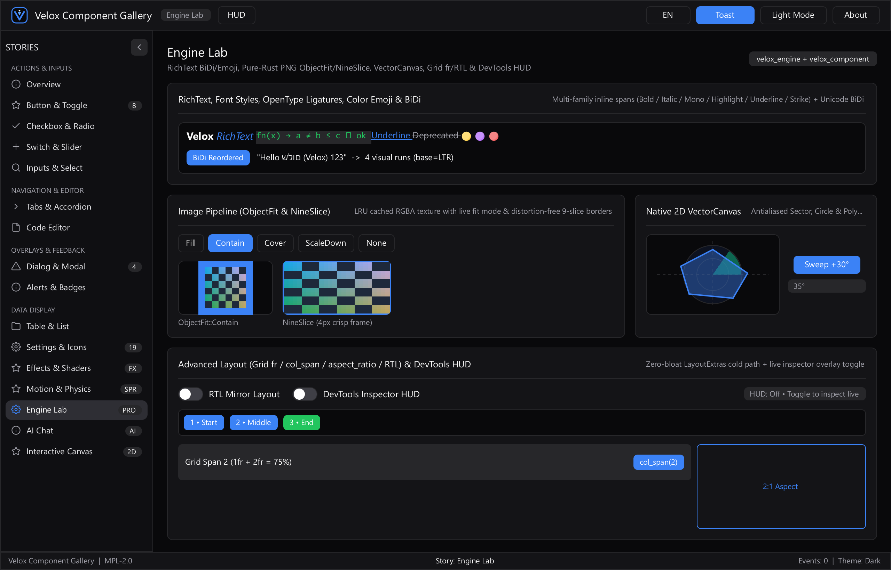 |
| Spring message bubbles, 3-dot wave typing indicator, live token cursor, reactions & jump-to-latest pill. | Multi-family typography, ligatures, BiDi reordering, strict-budget PNG image cache, NineSlice & antialiased 2D radar. |

### Modern Forms & Native Code Editor

| Password Eye Toggle, Clean Grouped OTP & Slot Calendar | Multi-Line Rust Code Editor (Native IME Caret Tracking) |
| :---: | :---: |
| 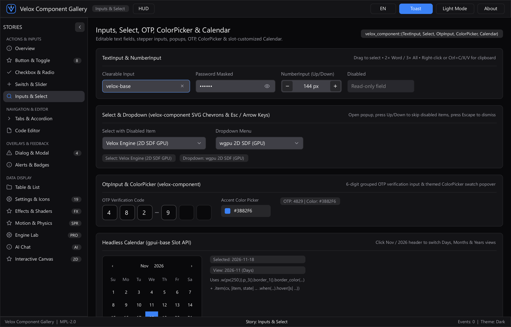 | 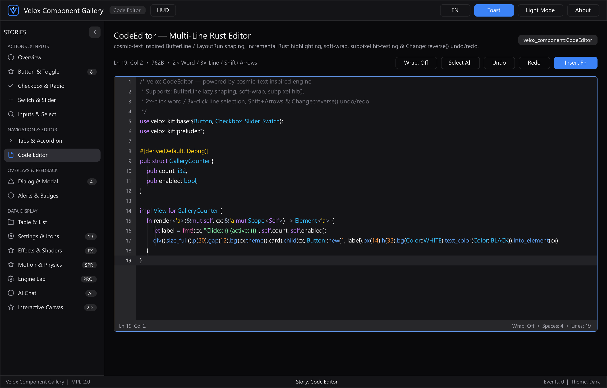 |
| Clearable inputs, password eye visibility toggle, crisp grouped OTP cells, color picker & symmetric animated popovers. | Incremental Rust highlighting, soft wrap, subpixel drag selection, OS clipboard & pixel-accurate IME candidate tracking. |

### Semantic Buttons & Interactive Data Views

| 8 Semantic Variants & Toggle Groups | Sortable Tables, Lists & Animated Interactive Charts |
| :---: | :---: |
| 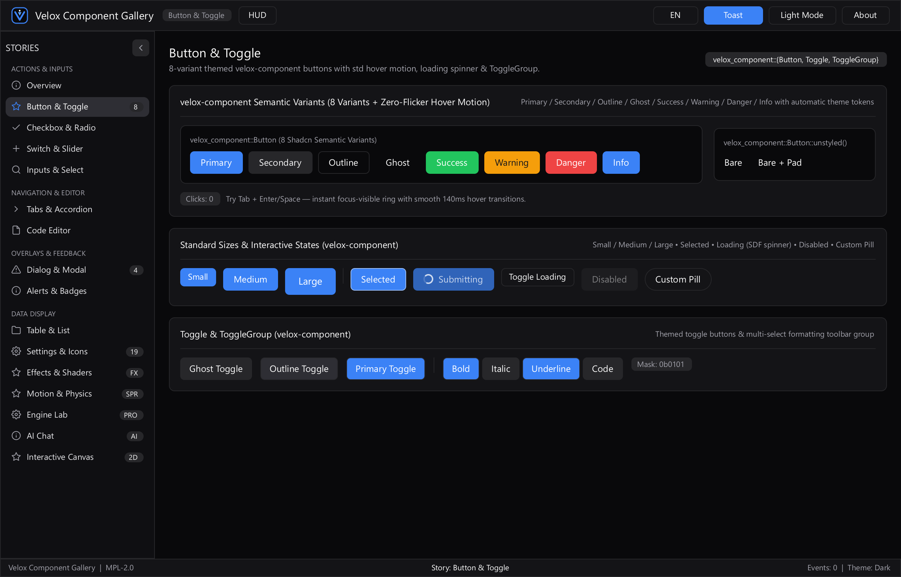 | 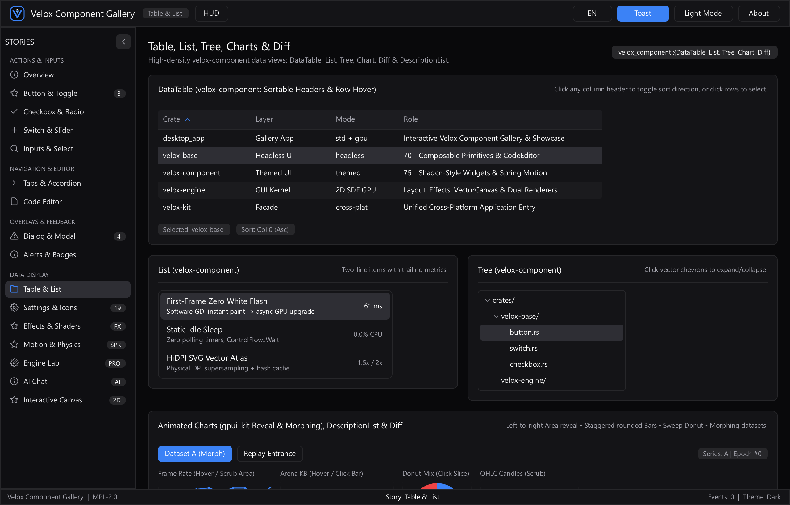 |
| 8 semantic styles, flicker-free hover transitions, loading spinners, pills & `ToggleGroup`. | Sortable `DataTable`, expandable `Tree`, `Diff` viewer, and animated `Chart` with hover tracking & slice explosion. |

---

## Built-In Component Ecosystem

| Category | Widgets Included |
| --- | --- |
| **Inputs & Forms** | `Button`, `Toggle`, `ToggleGroup`, `Checkbox` (tri-state), `RadioGroup`, `Switch`, `Slider`, `TextInput` (clearable / password eye toggle / drag select / OS clipboard), `NumberInput`, `OtpInput`, `Textarea`, `Select`, `Dropdown`, `ColorPicker`, `Calendar` |
| **Navigation & Layout** | `Sidebar`, `Tabs` (Segmented / Underline / Pill), `Accordion`, `Breadcrumb`, `Stepper`, `Pagination`, `StatusBar`, `ResizableSplit`, `VirtualList`, `Navigator` |
| **Overlays & Feedback** | `Dialog`, `AlertDialog`, `Modal`, `Sheet` (4-sided drawer), `Notification`, `Toast`, `Alert`, `Badge`, `Tag`, `Tooltip`, `Popover`, `ContextMenu`, `ProgressBar`, `ArcGauge`, `Spinner`, `Skeleton`, `Rating`, `Avatar`, `Kbd` |
| **Data & Pro Apps** | `DataTable`, `List`, `Tree`, `Chart` (Line / Area / Bar / Donut Pie / Candlestick with hover tracking & morphing), `Diff`, `DescriptionList`, `CodeEditor`, `SyntaxEditor`, `Message` / `Bubble` / `MessageScroller` (AI Chat), `Settings` |
| **Effects, Motion & Graphics** | `SpringAnimator`, `SpringProgress`, `SpringCard`, `SpringReveal`, `Carousel`, `Roller`, `VectorCanvas`, `RichText`, `Image` (built-in PNG/BMP & `NineSlice`), `Svg`, `Icon` (21 built-in Lucide vector icons), `SurfaceCanvas` (zero-copy external textures) |

---

## Platforms & Optional Features

| Target | Support | Examples |
| --- | --- | --- |
| **Windows / macOS / Linux** | Native window (`wgpu` GPU acceleration / software fallback / Pure Wayland) | `examples/desktop_app`, `examples/hello_world` |
| **Android / iOS / HarmonyOS** | Native Surface / Metal / XComponent host integration | `examples/android_app`, `examples/ios_app`, `examples/harmony_app` |
| **Web (WASM)** | WebAssembly Canvas / WebGPU runtime | `examples/web_app` |
| **Zero-Copy Host Interop** | Unified C ABI + DX12 / Vulkan DMA-BUF / IOSurface (Qt6 / WPF / WinUI 3 / GTK4) | `features = ["gpu-interop"]` |

Enable only what you need:

```toml
[dependencies]
# Batteries included: native desktop window + GPU renderer + 75+ themed widgets + 2D canvas
velox-kit = "0.4"

# Zero-copy cross-framework GPU interop (embed inside Qt, WPF, WinUI 3, GTK4, etc.)
# velox-kit = { version = "0.4", features = ["gpu-interop"] }

# Pair with Tokio async runtime / custom WGSL shaders, or switch to lightweight software rendering
# velox-kit = { version = "0.4", features = ["tokio", "custom-shader"] }
# velox-kit = { version = "0.4", default-features = false, features = ["winit", "component"] }
```

---

## Workspace Overview

| Crate | Purpose |
| --- | --- |
| **`velox-kit`** | Recommended all-in-one entry crate for building applications |
| **`velox-component`** | 75+ Shadcn-inspired themed widgets & `motion` spring animation suite |
| **`velox-canvas`** | High-density 2D interactive canvas (Hilbert R-Tree, semantic LOD, viewport & `Minimap`) |
| **`velox-base`** | Headless composable primitives, code editor, virtual lists & router |
| **`velox-engine`** | Core layout, rendering, Motion 2.0, effects, RichText, image pipeline & platform runtime |
| **`velox-async`** | Optional `tokio` / `smol` async scheduler adapters |

> **AI-Ready**: Ships with progressive-disclosure agent skills ([skills/velox-kit](skills/velox-kit/SKILL.md) and [skills/velox-design-guides](skills/velox-design-guides/SKILL.md)) so AI coding assistants write idiomatic Velox UI out of the box.

---

## Useful Commands

```bash
# Run the full workspace unit & gallery integration test suite
cargo test --workspace

# Export a crisp 2x HiDPI lossless PNG snapshot of any gallery story
cargo run -p desktop_app -- --story overview --scale 2 --save-png preview.png

# Run with the built-in software renderer
cargo run -p desktop_app -- --software
```

Available `--story` pages: `overview` · `buttons` · `selection` · `sliders` · `inputs` · `navigation` · `editor` · `overlays` · `feedback` · `data` · `icons` · `effects` · `motion` · `engine` · `chat` · `canvas`


---

## License

Licensed under the **Mozilla Public License 2.0 (`MPL-2.0`)**. See [LICENSE](LICENSE) for full terms.

- You may freely link unmodified Velox crates into open-source or proprietary commercial applications;
- Modifications to Velox framework files themselves must be shared under `MPL-2.0`.
