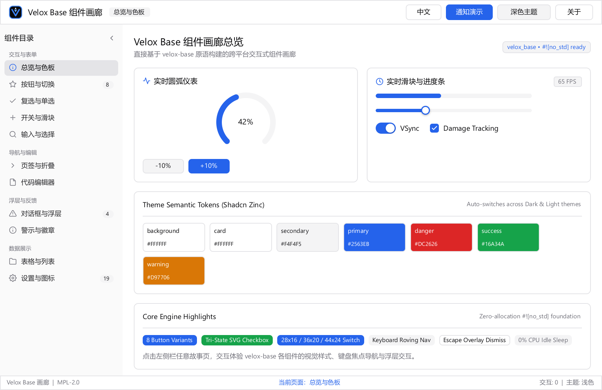
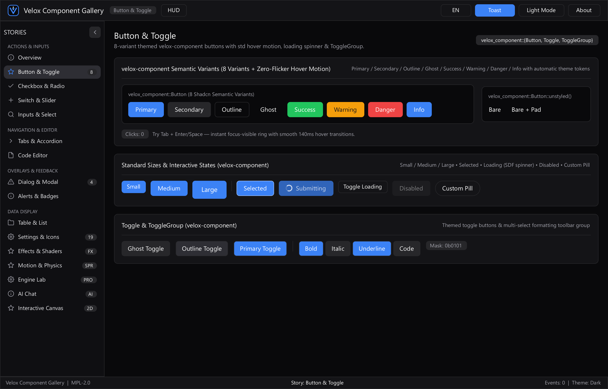
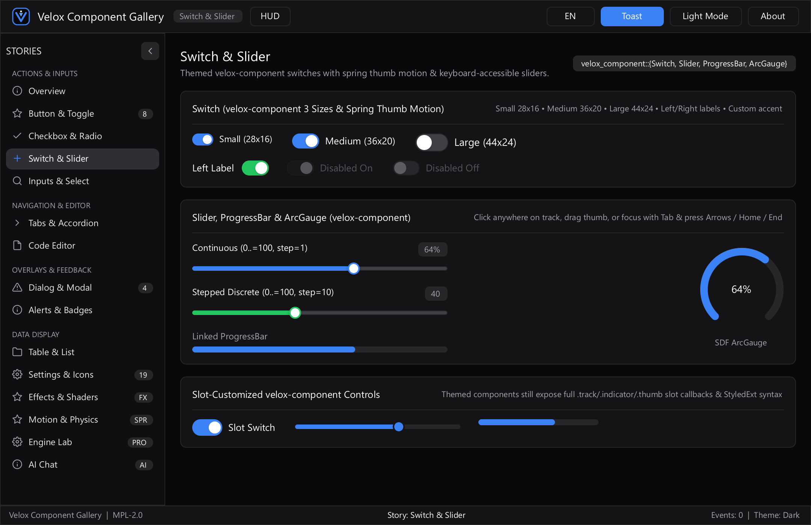
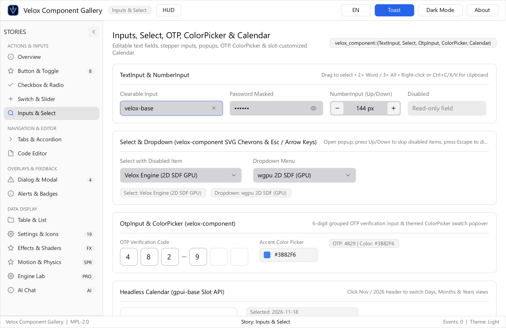
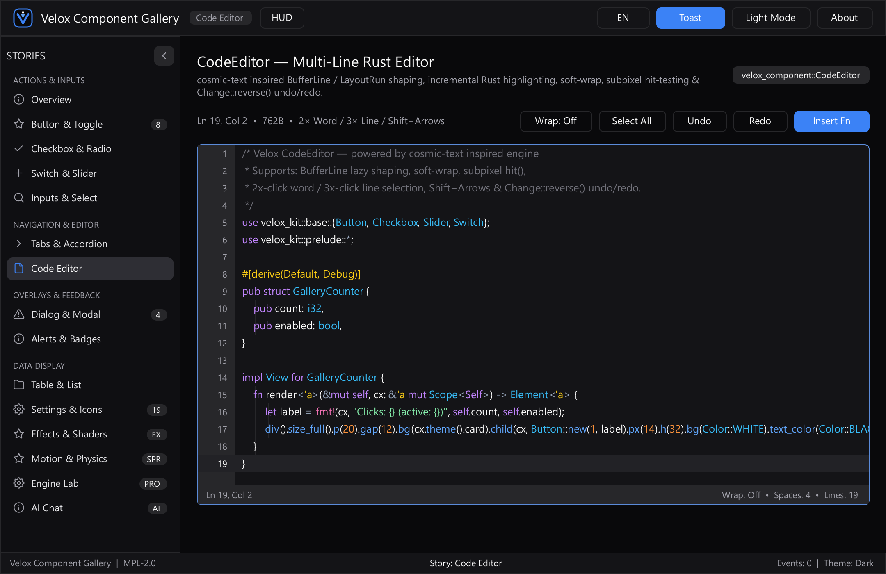
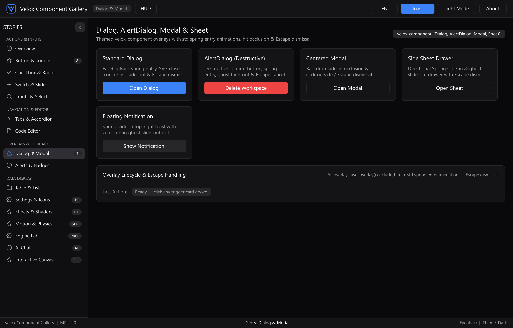

# Velox GUI Framework

> 轻量级、帧级零堆分配友好的跨平台 Rust GUI 框架，基于 **`MPL-2.0`** 开源协议发布。

## 核心特性

- **帧级零堆瞬态内存**：`ScratchArena` 帧级瞬态分配、`PodPool` / `Handle<T>` 稳定状态池与局部重绘边界，原生覆盖桌面（Windows / macOS / Pure Wayland）、移动（Android / iOS / HarmonyOS）与 WebAssembly 目标。
- **双渲染后端与 HiDPI 精准排版**：默认启用自研轻量级 `wgpu` 2D SDF 单 Pass Instanced GPU 硬件渲染器，内置软件 SDF 扫描线光栅器；支持 `0.25px` 亚像素精确字号光栅化（125% / 150% / 175% / 200% DPI 零漂移）与 24×24 原生矢量 SVG 图标图集缓存。
- **按需刷新与 0% CPU 休眠**：跨帧脏矩形追踪（`DamageTracker`）、0 脏区跳过 GPU 提交，静止状态下自动进入事件驱动休眠。
- **完备文本与代码编辑引擎**：基于 `BufferLine` / `TextDocBuffer` / `CosmicEditor` / `SyntaxEditor` 的按需排版管线，支持软折行、530ms 标准闪烁叠层光标、亚像素鼠标任意拖选、双击选词/三击选行、全套快捷键（`Ctrl+A/C/X/V/Z/Y`、`Shift+方向键`）、右键上下文菜单与跨平台原生系统剪贴板。
- **语义化双主题与国际化**：内置 `Dark` / `Light` 现代中性语义令牌（`CoreTheme`）、动态指针形状（`CursorShape`）、键盘可见焦点环（`:focus-visible`）及编译期静态多语言目录（`Locale` / `cx.t(...)`）。

## Crate 分层架构

- `crates/velox-engine`：核心 UI 引擎内核
  - 帧级瞬态内存管理（`ScratchArena`、`SmallVec`、`StrRef`）
  - 状态池、细粒度响应式信号与局部重绘边界（`PodPool`、`Handle<T>`、`Signal<T>`、`View`、`Widget`）
  - 四步一维弹性布局求解器（`Two-Pass Axis Solver`）、跨帧插值动画（`MotionCache` / `Tween` / `Presence`）与脏矩形合并器（`DamageTracker`）
  - 双渲染后端：`gpu`（`wgpu` 2D SDF 单 Pass Instanced 渲染器）与 `software`（内置 SDF 扫描线光栅化）
  - 跨平台窗口、剪贴板与事件层：`winit`、`wayland`（纯客户端二进制协议）、`mobile`（Android / iOS / HarmonyOS）、`web`（WebAssembly）、`testing`（无头确定性测试）
- `crates/velox-base`：70+ 可组合基础组件、文本/代码编辑引擎（`EditableText`、`TextInput`、`Textarea`、`CodeEditor`、`SyntaxEditor`）、页面路由栈（`Navigator`）与虚拟滚动列表（`VirtualList` / `UniformList`）
- `crates/velox-component`：Tailwind 风格主题化 UI 组件库
- `crates/velox-async`：可选异步调度器适配层（`tokio` / `smol`）
- `crates/velox-kit`：应用层统一入口 Crate（重导出 `velox-engine`、`velox-base`、`velox-component` 与 `velox-async`）

## 快速开始

在 `Cargo.toml` 中引入统一入口 `velox-kit`：

```toml
[dependencies]
velox-kit = "0.1"
```

如需关闭 GPU 默认后端（仅使用内置软件光栅器）或开启 Tokio / smol 异步调度器：

```toml
[dependencies]
velox-kit = { version = "0.1", default-features = false, features = ["winit", "component", "tokio"] }
```

## Velox Base Gallery 组件画廊 (`examples/desktop_app`)

`examples/desktop_app` 是直接基于 `velox-base` 原语构建的跨平台交互式组件画廊（默认窗口逻辑尺寸 `1080×700`），覆盖全部高频桌面交互、键盘无障碍导航、浮层遮罩与多语言热切换：

- **应用壳层**：顶部栏内置 `EN / 中文 / 日本語` 三语实时切换、右上角浮动 `Toast` 通知触发、`Dark / Light` 主题即时切换与 `About` 模态对话框；左侧提供 4 大分组可折叠 `Sidebar`；底部为实时事件计数与主题状态 `StatusBar`；在输入框与代码编辑器内右击可唤起不抢焦点的 `ContextMenu`（`Cut` / `Copy` / `Paste` / `Select All`），直接与系统剪贴板互通。

### 界面预览与说明

以下截图均由 `desktop_app` 通过硬件 `wgpu` 2D SDF 管线在 **150% HiDPI (`1620×1050`)** 下实机离屏渲染生成：

| Overview（暗色主题 · 英文） | Overview（亮色主题 · 中文热切换） |
| :---: | :---: |
|  |  |
| 展示完整画廊壳层（顶栏、4 分组可折叠 `Sidebar`、底栏 `StatusBar`）、实时 SDF `ArcGauge` / `Slider` / `Switch` 体验台与现代中性语义色板。 | 点击顶栏即可零重启切换 `ThemeMode::Light` 与 `zh-CN` 静态多语言目录，全部侧边栏、标题、按钮与状态栏同步更新。 |

| Button & Toggle（按钮与切换组） | Switch & Slider（开关、滑块与 SDF 仪表） |
| :---: | :---: |
|  |  |
| 8 档语义变体（`Primary` / `Secondary` / `Outline` / `Ghost` / `Danger` / `Success` / `Warning` / `Info`）、3 档尺寸、旋转等待 `Loading` 态、`Unstyled` 逃生舱与 `ToggleGroup`。 | 3 档标准尺寸开关（`28×16` / `36×20` / `44×24`）及左右标签、连续与步进 `Slider`，以及实时联动的 `ProgressBar` 与解析圆弧 SDF `ArcGauge`。 |

| Inputs & Select（输入框、选区与右键菜单） | Code Editor（多行 Rust 代码编辑器） |
| :---: | :---: |
|  |  |
| 4 组输入控件严密齐平；支持 530ms 闪烁细光标、亚像素鼠标任意拖选（图示选中 `velox`）、双击选词/三击全选，以及不丢焦点的右键 `ContextMenu` 系统剪贴板复制粘贴。 | 基于 `BufferLine` / `LayoutRun` 的按需排版与增量 Rust 语法高亮，提供行号、缩进参考线、软折行切换、撤销/重做与实时行列状态栏。 |

| Dialog & Modal（浮层模态与遮罩拦截） | Table, List & Tree（数据密集型视图） |
| :---: | :---: |
|  |  |
| 顶层 `.overlay().occlude_hit()` 全屏半透明遮罩严格拦截底层事件，支持解析圆角高斯柔和阴影、原生 SVG 关闭图标与 `Esc` 键关闭。 | 可点击表头排序与行选中的 `DataTable`、带右侧性能指标的双行 `List`，以及带矢量展开箭头的层级 `Tree` 视图。 |

### 11 个交互故事页一览

| 分组 | 故事页 | `--story` 参数 | 展示组件与交互能力 |
| --- | --- | --- | --- |
| **ACTIONS & INPUTS** | Overview | `overview` | 语义主题色板矩阵、实时交互快速体验台（`ArcGauge`、`Slider`、`Switch`、`Checkbox`、`ProgressBar`）与核心特性徽章 |
| | Button & Toggle | `buttons` | 8 档语义变体、3 档尺寸、`Selected` / `Loading`（旋转动画）/ `Disabled` / `Unstyled` 按钮，以及 `Toggle` 与 `ToggleGroup` |
| | Checkbox & Radio | `selection` | 三态（未选/已选/半选）父子联动原生 SVG 复选框、键盘方向键循环切换 `RadioGroup` |
| | Switch & Slider | `sliders` | 3 档标准尺寸（`28×16` / `36×20` / `44×24`）左右标签开关、连续/步进滑块与联动 `ProgressBar` / SDF `ArcGauge` |
| | Inputs & Select | `inputs` | 可清空/密码掩码/禁用 `TextInput`（530ms 闪烁光标、鼠标任意拖选、双/三击选词全选、右键剪贴板菜单）、`NumberInput`、`Select` 与 `Dropdown` |
| **NAVIGATION & EDITOR** | Tabs & Accordion | `navigation` | `Tabs` 三变体（`Segmented` / `Underline` / `Pill`）、可折叠 `Accordion`、`Stepper` 步骤条与 `Pagination` 分页器 |
| | Code Editor | `editor` | 完整 `CodeEditor`（Rust 语法高亮、软折行切换、行号与诊断指示、缩进参考线、亚像素拖选、双/三击选词选行、撤销/重做与右键复制粘贴） |
| **OVERLAYS & FEEDBACK** | Dialog & Modal | `overlays` | 交互式唤起 `Dialog`、`AlertDialog`（危险确认）、`Modal` 与侧边抽屉 `Sheet`（顶层遮罩命中拦截与 `Esc` 关闭） |
| | Alerts & Badges | `feedback` | 4 档矢量图标 `Alert`、8 档 `Badge`、`Tag`、`Tooltip`、`Popover`、`Kbd` 快捷键与带在线状态 `Avatar` |
| **DATA DISPLAY** | Table & List | `data` | 可点击表头排序与行选中的 `DataTable`、交互列表 `List` 与可展开/折叠层级 `Tree` |
| | Settings & Icons | `icons` / `settings` | 分组应用设置面板 `Settings`（内置开关切换）与 19 个内置 Lucide 矢量 `IconName` 全览展板 |

### 画廊运行方式与 CLI 参数

```powershell
# 默认启动原生桌面画廊窗口（wgpu 2D SDF GPU 硬件加速，暗色主题）
cargo run -p desktop_app

# 直达指定故事页并以亮色主题 + 中文界面启动
cargo run -p desktop_app -- --story inputs --light --lang zh

# 直接打开代码编辑器故事页
cargo run -p desktop_app -- --story editor

# 切换内置软件光栅渲染器运行
cargo run -p desktop_app -- --software

# 渲染并导出指定故事页的 2x HiDPI 无损 PNG 快照
cargo run -p desktop_app -- --story overview --scale 2 --save-png gallery.png

# 无头模式验证 Winit 局部脏区刷新与 Wayland 0% CPU 休眠
cargo run -p desktop_app -- --headless
```

支持的 CLI 参数：

| 参数 | 说明 |
| --- | --- |
| `--window`（默认） | 启动原生桌面画廊窗口（Windows / macOS / Pure Wayland） |
| `--software` | 切换至内置软件 SDF 光栅渲染器（`DesktopRenderBackend::Software`） |
| `--light` | 以亮色主题（`ThemeMode::Light`）启动（默认暗色 `ThemeMode::Dark`） |
| `--story <name>` | 直达指定故事页：`overview` / `buttons` / `selection` / `sliders` / `inputs` / `navigation` / `editor` / `overlays` / `feedback` / `data` / `icons` |
| `--lang <en\|zh\|ja>` | 指定初始显示语言（默认 `en`） |
| `--scale <1..4>` | 覆盖 HiDPI 缩放倍率（窗口模式默认自动跟随系统 DPI，无头/截图模式默认 `2`） |
| `--save-png <path>` | 渲染首帧并导出无损 PNG 画廊快照后退出 |
| `--headless` | 无显示服务器环境下执行确定性帧步进、脏区与空闲休眠验证 |

## 其他示例应用 (`examples/`)

- `examples/android_app`：Android JNI / NDK Surface 示例
- `examples/ios_app`：iOS UIKit / Metal 示例
- `examples/harmony_app`：HarmonyOS NEXT XComponent 示例
- `examples/web_app`：WebAssembly (`wasm32-wasip2`) HTML5 Canvas 示例

## AI Agent 技能 (`skills/`)

仓库内提供遵循渐进式披露规范的编码与界面设计技能，已通过 `.agents/skills.json` 自动注册：

- `skills/velox-kit`：Velox 架构规范、`ScratchArena` 生命周期、`View`/`PodPool`、`Signal<T>`、70+ 组件目录、平台后端与无头集成测试指南（[SKILL.md](skills/velox-kit/SKILL.md)）
- `skills/velox-design-guides`：跨桌面/移动端 `CoreTheme` 语义令牌、壳层布局、浮层遮罩与动效节能设计规范（[SKILL.md](skills/velox-design-guides/SKILL.md)）

## 构建与测试

```powershell
# 运行全工作区单元测试与集成测试
cargo test --workspace

# 验证最小软光栅裁剪构建矩阵与可选异步调度器特性
cargo check -p velox-engine --no-default-features
cargo check -p velox-kit --no-default-features --features component
cargo test -p velox-async --all-features
cargo test -p velox-kit --features tokio,smol

# 生成全工作区 API 文档
cargo doc --no-deps --workspace
```

## 开源协议

本项目采用 **Mozilla Public License 2.0 (`MPL-2.0`)** 开源，完整条款见 [LICENSE](LICENSE)。

- 对 `velox` 框架本身文件（Covered Software）的修改必须以 `MPL-2.0` 公开源码；
- 下游应用（`Larger Work`）可直接静态链接未修改的 `velox` 库（支持搭配 `GPL-3.0` 等开源桌面项目或专有商业软件）。
