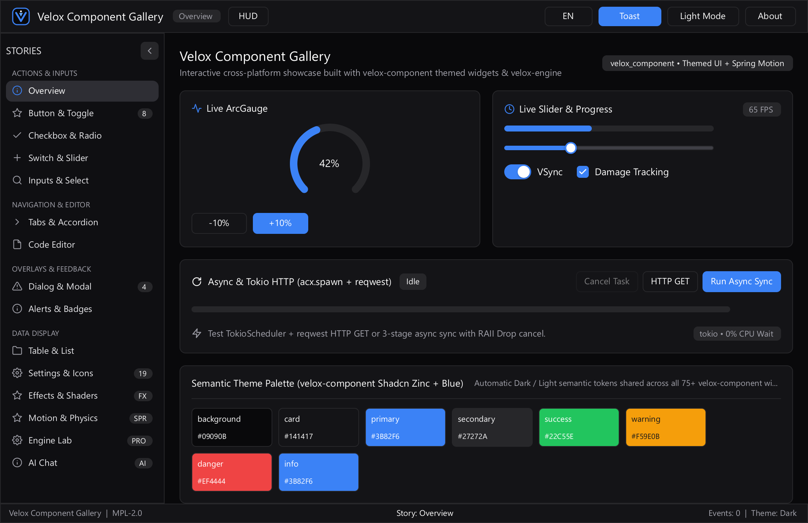
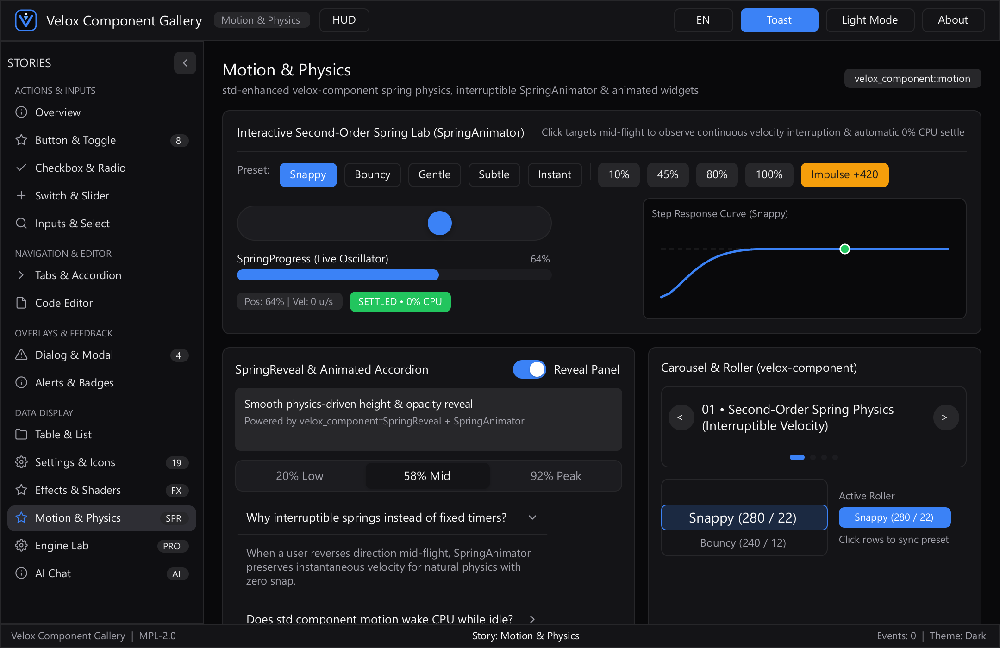
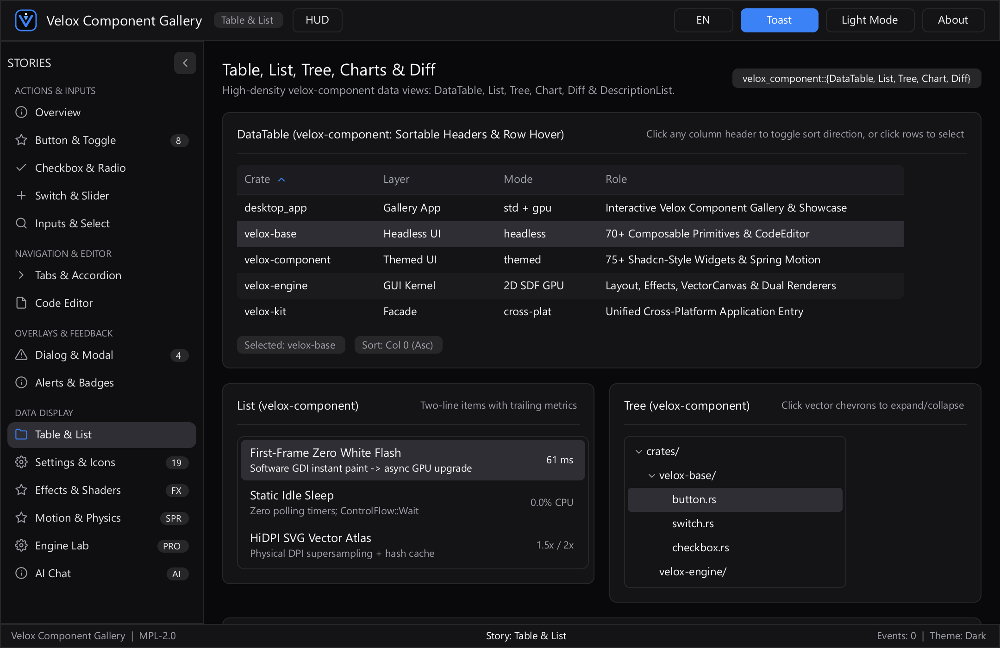

<div align="center">

# Velox

**现代、极速、高颜值的跨平台 Rust 原生 GUI 框架**

一套纯 Rust 声明式代码，构建桌面、移动与 Web 原生体验 —— 75+ 主题组件、物理弹簧动效、实时毛玻璃特效与 **0% CPU 静止休眠**。

<p>
  <strong>简体中文</strong> &nbsp;|&nbsp; <a href="README.en.md">English</a>
</p>

<p>
  <a href="https://crates.io/crates/velox-kit"></a>
  <a href="https://docs.rs/velox-kit"></a>
  <a href="LICENSE"></a>
  
</p>



</div>

---

## 为什么选择 Velox？

- **🎨 75+ 开箱即用的现代主题组件**：内置 Shadcn / Tailwind 风格设计系统，一键切换亮色 / 暗色主题与多语言，涵盖按钮、表单、密码查看、分格 OTP 验证码、日期选择、代码编辑器、数据表、交互图表、抽屉、弹窗与 AI 对话流。
- **✨ 丝滑物理弹簧动效 + 0% CPU 休眠**：按钮、开关、进度条、页签、弹窗、图表与聊天气泡默认自带可打断二阶物理弹簧动画；画面静止后自动挂起，**零轮询、零电量浪费**。
- **🪟 GPU 硬件加速与现代视觉特效**：自带轻量 2D GPU 渲染管线（无 GPU 时自动回退软件光栅），原生支持多色标 OKLab 渐变、实时 Acrylic 毛玻璃、27 种混合模式、柔和阴影、SVG 路径裁剪与抗锯齿矢量画布。
- **⚡ 优雅的 Rust 链式写法**：无 WebView 内存负担、无需 HTML/CSS 桥接、无需复杂宏魔法，直观的 Flexbox / Grid 链式 API 让你像写 Tailwind 一样快速构建原生应用。
- **📱 全平台一次编写**：原生覆盖 **Windows、macOS、Linux（Wayland / X11）、Android、iOS、HarmonyOS NEXT** 与 **WebAssembly**。
- **🔌 零拷贝融合外部渲染**：支持将 3D 引擎、地图/海图或视频画面零拷贝嵌入 Velox 界面，也可将 Velox 作为透明 HUD 直接零拷贝嵌入 Qt、WPF、WinUI 3 与 GTK4。

---

## 30 秒快速上手

在 `Cargo.toml` 中添加统一入口 `velox-kit`：

```toml
[dependencies]
velox-kit = "0.3"
```

编写你的第一个 Velox 原生桌面应用：

```rust
use velox_kit::prelude::*;

pub struct HelloWorld {
    clicks: u32,
}

impl View for HelloWorld {
    fn render<'a>(&mut self, cx: &'a mut Scope<Self>) -> Element<'a> {
        let on_click = cx.listener(|this, _: ClickEvent, _| {
            this.clicks += 1;
        });

        div()
            .flex_col()
            .gap(12)
            .size_full()
            .items_center()
            .justify_center()
            .bg(cx.theme().background)
            .child(
                cx,
                text(fmt!(cx, "Hello, Velox! ({})", self.clicks))
                    .size(20)
                    .color(cx.theme().foreground),
            )
            .child(
                cx,
                Button::new(1, "Let's Go!")
                    .primary()
                    .medium()
                    .on_click(on_click),
            )
            .into_element(cx)
    }
}

fn main() {
    velox_kit::application().run(|cx| {
        velox_kit::init(cx);
        velox_kit::open_window(
            WindowOptions::new("Hello Velox").size(480, 320),
            cx,
            |cx| cx.new(|_| HelloWorld { clicks: 0 }),
        )
        .expect("Failed to open window");
    });
}
```

### 立即体验 15 页互动组件画廊

```bash
# 启动原生 GPU 硬件加速桌面组件画廊
cargo run -p desktop_app

# 直达指定亮点页面（支持亮色主题与中/英/日三语实时切换）
cargo run -p desktop_app -- --story effects
cargo run -p desktop_app -- --story motion
cargo run -p desktop_app -- --story chat
cargo run -p desktop_app -- --story inputs --light --lang zh
```

---

## 实机效果预览

以下全部界面均由 Velox 原生渲染引擎在 **2× HiDPI** 下实机渲染导出，无任何 WebView 或外部 CSS 依赖：

### 亮色 / 暗色主题与多语言实时热切换

| 暗色主题（英文） | 亮色主题（中文零重启切换） |
| :---: | :---: |
|  |  |
| 完整应用壳层、响应式仪表盘、Tokio 异步任务演示与现代语义色板。 | 顶栏一键即时切换亮/暗主题与多语言目录，全部组件同步过渡。 |

### GPU 特效实验室 & 物理弹簧动效

| 实时毛玻璃、OKLab 渐变与混合模式 | 二阶物理弹簧实验室与实时示波器 |
| :---: | :---: |
|  |  |
| 感知均匀 OKLab 渐变、圆锥光谱、实时 Acrylic 毛玻璃、27 种混合模式与 SVG 裁剪。 | 5 档物理弹簧预设、运动中途平滑打断、速度冲量与自动 0% CPU 收敛。 |

### AI 流式对话 & 富文本 / 矢量画布

| AI 对话流与流式打字机 | 富文本 BiDi / Emoji、图片管线与矢量雷达 |
| :---: | :---: |
|  |  |
| 弹簧弹入消息气泡、3 点思考波浪、流式光标、互动表情与回底悬浮按钮。 | 多字族/编程连字/双向文本排版、纯 Rust PNG 解码、九宫格拉伸与抗锯齿矢量画布。 |

### 现代输入表单 & 原生代码编辑器

| 密码小眼睛、分格 OTP、选择器与日历 | 多行 Rust 语法高亮代码编辑器 |
| :---: | :---: |
|  |  |
| 一键清空输入、带小眼睛切换的密码框、无外框分组 OTP 验证码、取色器与插槽日历。 | 增量语法高亮、软折行、亚像素鼠标拖选、双/三击选词选行、撤销重做与系统剪贴板。 |

### 语义按钮体系 & 数据表与交互图表

| 8 档语义按钮与切换组 | 可排序数据表、指标列表与交互式动画图表 |
| :---: | :---: |
|  |  |
| 8 种语义变体、无闪烁平滑悬停过渡、Loading 加载态、圆角胶囊与 `ToggleGroup`。 | 支持排序与选中的 `DataTable`、树形目录、Diff 对比及带悬停追踪与扇区弹出动画的 `Chart`。 |

---

## 丰富的开箱即用组件生态

| 类别 | 内置组件 |
| --- | --- |
| **基础与表单** | `Button`、`Toggle`、`ToggleGroup`、`Checkbox`（三态）、`RadioGroup`、`Switch`、`Slider`、`TextInput`（清空 / 密码小眼睛 / 拖选 / 右键剪贴板）、`NumberInput`、`OtpInput`、`Textarea`、`Select`、`Dropdown`、`ColorPicker`、`Calendar` |
| **导航与布局** | `Sidebar`、`Tabs`（分段 / 下划线 / 胶囊）、`Accordion`、`Breadcrumb`、`Stepper`、`Pagination`、`StatusBar`、`ResizableSplit`、`VirtualList`、`Navigator` |
| **反馈与浮层** | `Dialog`、`AlertDialog`、`Modal`、`Sheet`（四向抽屉）、`Notification`、`Toast`、`Alert`、`Badge`、`Tag`、`Tooltip`、`Popover`、`ContextMenu`、`ProgressBar`、`ArcGauge`、`Spinner`、`Skeleton`、`Rating`、`Avatar`、`Kbd` |
| **数据与专业场景** | `DataTable`、`List`、`Tree`、`Chart`（折线 / 面积 / 柱状 / 环形饼图 / K 线，含悬停追踪与 Morphing 动效）、`Diff`、`DescriptionList`、`CodeEditor`、`SyntaxEditor`、`Message` / `Bubble` / `MessageScroller`（AI 对话流）、`Settings` |
| **特效、动效与图形** | `SpringAnimator`、`SpringProgress`、`SpringCard`、`SpringReveal`、`Carousel`、`Roller`、`VectorCanvas`、`RichText`、`Image`（内置 PNG/BMP 解码与 `NineSlice`）、`Svg`、`Icon`（21 个内置 Lucide 矢量图标）、`SurfaceCanvas`（外部零拷贝纹理） |

---

## 全平台与可选特性

| 平台 | 支持形态 | 示例入口 |
| --- | --- | --- |
| **Windows / macOS / Linux** | 原生窗口（`wgpu` GPU 加速 / 自动软件回退 / Pure Wayland） | `examples/desktop_app`、`examples/hello_world` |
| **Android / iOS / HarmonyOS** | 原生 Surface / Metal / XComponent 宿主桥接 | `examples/android_app`、`examples/ios_app`、`examples/harmony_app` |
| **Web (WASM)** | WebAssembly Canvas / WebGPU 运行时 | `examples/web_app` |
| **宿主框架零拷贝嵌入** | 统一 C ABI + DX12 / Vulkan DMA-BUF / IOSurface（Qt6 / WPF / WinUI 3 / GTK4） | `features = ["gpu-interop"]` |

按需启用特性组合：

```toml
[dependencies]
# 默认开箱即用：桌面原生窗口 + GPU 硬件加速 + 75+ 主题组件
velox-kit = "0.3"

# 启用跨框架零拷贝 GPU 互操作（嵌入 Qt / WPF / WinUI 3 / GTK4 等）
# velox-kit = { version = "0.3", features = ["gpu-interop"] }

# 搭配 Tokio 异步运行时，或切换轻量纯软件渲染模式
# velox-kit = { version = "0.3", features = ["tokio"] }
# velox-kit = { version = "0.3", default-features = false, features = ["winit", "component"] }
```

---

## 工作区结构

| Crate | 定位 |
| --- | --- |
| **`velox-kit`** | 推荐应用层统一入口，一站式引入引擎、组件与异步适配 |
| **`velox-component`** | 75+ Shadcn 风格主题化组件库与 `motion` 物理弹簧动效体系 |
| **`velox-base`** | 无头可组合组件原语、代码编辑器、虚拟列表与路由栈 |
| **`velox-engine`** | 核心渲染、布局、动效、富文本、图片解码与跨平台窗口内核 |
| **`velox-async`** | 可选 `tokio` / `smol` 异步调度器集成 |

> **AI 辅助开发**：仓库内置遵循渐进式披露规范的编码与界面设计技能（[skills/velox-kit](skills/velox-kit/SKILL.md)、[skills/velox-design-guides](skills/velox-design-guides/SKILL.md)），让 AI 编码助手开箱即可写出地道高效的 Velox 界面。

---

## 画廊常用命令

```bash
# 运行全部自动化单元测试与画廊集成测试
cargo test --workspace

# 导出任意故事页的 2x HiDPI 无损 PNG 截图
cargo run -p desktop_app -- --story overview --scale 2 --save-png preview.png

# 切换内置软件渲染器运行
cargo run -p desktop_app -- --software
```

可用 `--story` 页面：`overview` · `buttons` · `selection` · `sliders` · `inputs` · `navigation` · `editor` · `overlays` · `feedback` · `data` · `icons` · `effects` · `motion` · `engine` · `chat`


---

## 开源协议

本项目基于 **Mozilla Public License 2.0 (`MPL-2.0`)** 开源，完整条款见 [LICENSE](LICENSE)。

- 你可以自由地将未修改的 Velox 静态链接至开源项目或专有商业软件中；
- 对 Velox 框架自身文件的修改需在 `MPL-2.0` 协议下保持开源。
